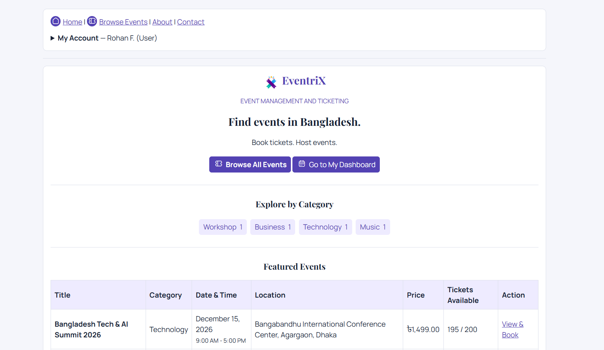
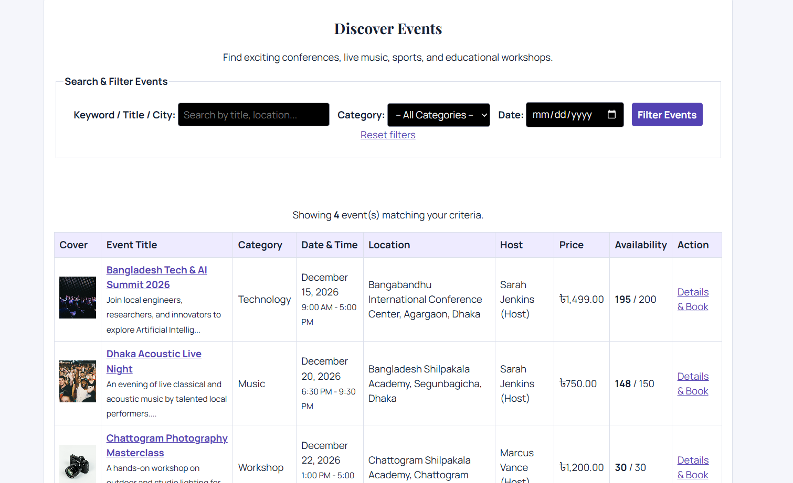
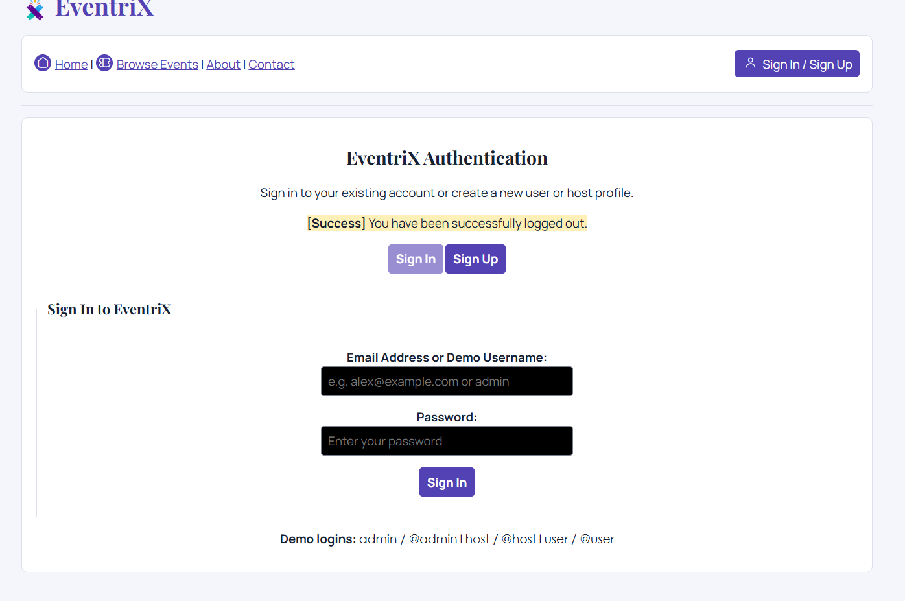
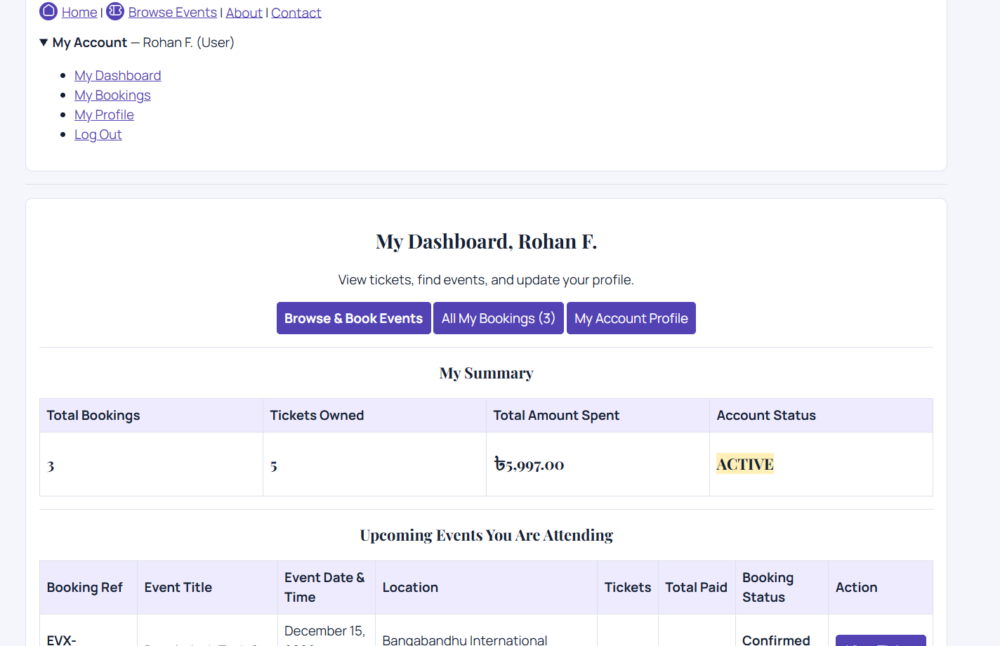
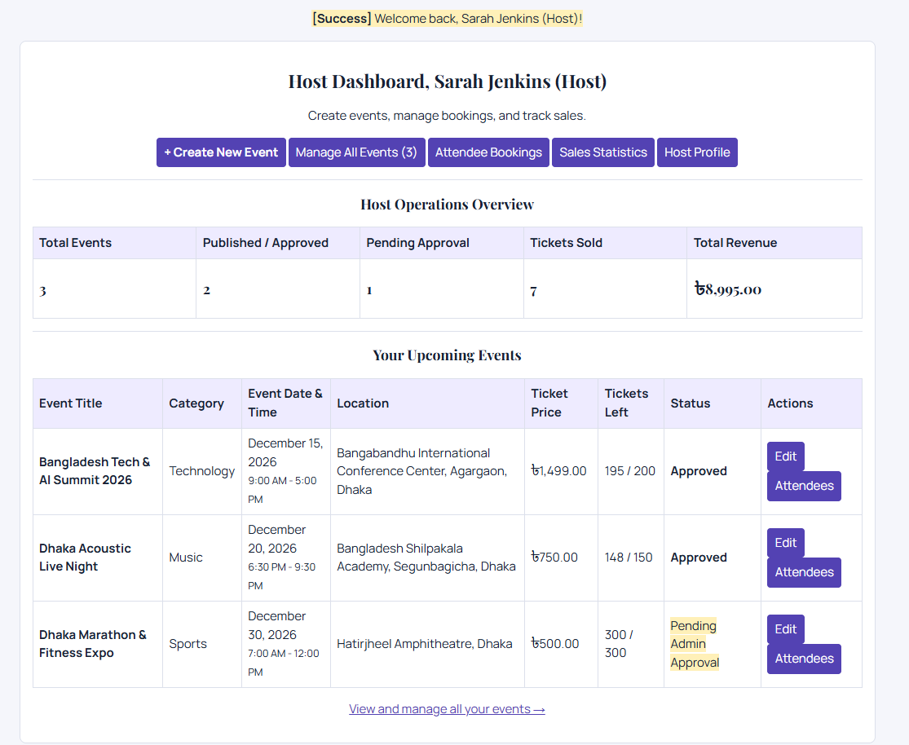
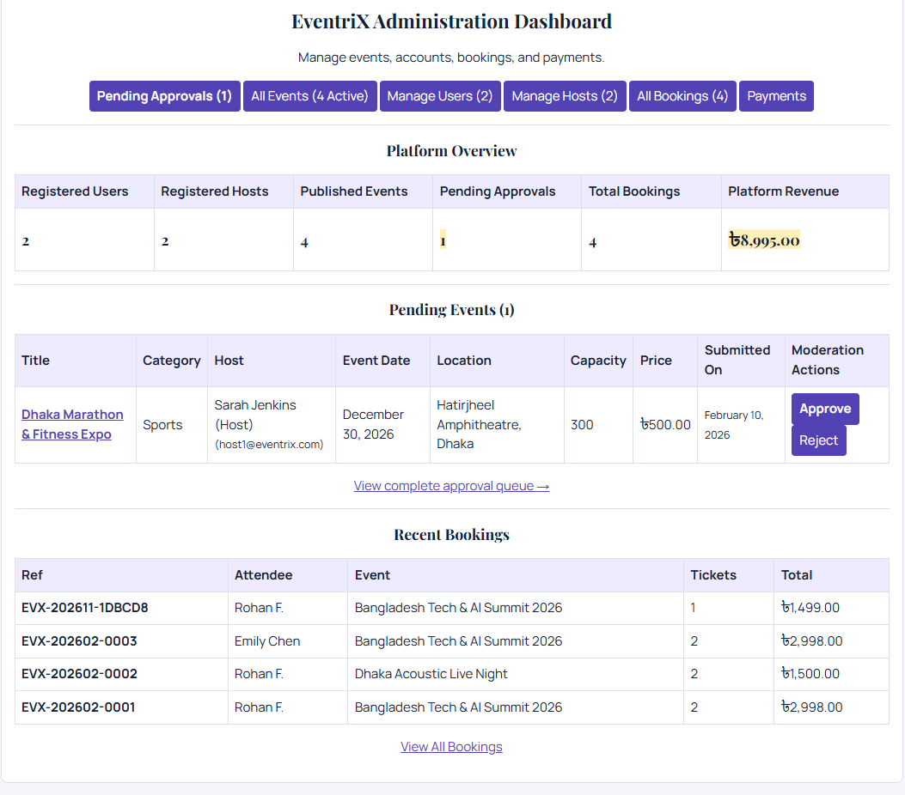

#  EventriX

EventriX is a **Web Technology - Course Project** for finding, hosting, and booking events in Bangladesh. Event listings show the date, venue, ticket price in taka (৳), and available tickets in one place.

## Why we built it

We wanted to show how a local event moves from an organizer’s submission to a confirmed ticket booking. The project applies course concepts such as HTML forms, PHP sessions, role-based access, and relational databases to one workflow that can be demonstrated in class.

## Who uses EventriX

| User | What they can do |
| --- | --- |
| Visitor | Browse approved events, filter by category, and view event details. |
| Attendee | Create an account, book available tickets, and view booking references and history. |
| Host | Create and edit events, set ticket prices and capacity, and view attendee bookings. |
| Administrator | Review event submissions and manage accounts, bookings, and payment records. |

For a class demo, sign in as a host and submit an event. Approve it as an administrator, then book a ticket as an attendee. The attendee receives a booking reference, and the available ticket count updates. The payment step records a demo payment in the database. It does not charge money.

## Screenshots

### Home

Browse event categories and see upcoming events on the landing page.

### Event listing

### Sign in

### Attendee dashboard

### Host dashboard

### Admin dashboard

## Technology

- **HTML and CSS** structure and style the pages with a shared stylesheet.
- **JavaScript** handles browser interactions such as switching between sign-in and sign-up.
- **PHP** handles authentication, permissions, and booking logic. It uses PDO to connect to MySQL.
- **MySQL or MariaDB** stores accounts, events, bookings, and payment records.
- **Apache** uses [`.htaccess`](.htaccess) to route public `.html` URLs to the corresponding PHP source files.

## Run locally with XAMPP

1. Clone this repository into your XAMPP `htdocs` directory. On Windows, the project path is typically `C:\xampp\htdocs\EventriX`.
2. Start **Apache** and **MySQL** in the XAMPP Control Panel. Apache needs `mod_rewrite` and permission to read the project’s `.htaccess`.
3. Open [phpMyAdmin](http://localhost/phpmyadmin/) and import [`database/eventrix.sql`](database/eventrix.sql) into your local setup. The script creates the `eventrix` database and loads sample data. Re-importing it replaces the project’s tables, so back up any data you want to keep.
4. If your database credentials differ from XAMPP’s defaults, edit [`includes/database.php`](includes/database.php).
5. Open [http://localhost/EventriX/index.html](http://localhost/EventriX/index.html).

### Local demo accounts

| Role | Username | Password |
| --- | --- | --- |
| Administrator | `admin` | `@admin` |
| Host | `host` | `@host` |
| Attendee | `user` | `@user` |

These accounts are for local testing. Replace the default passwords and remove the public demo-login hints before deploying the project.

## Credits

### Project contributors

- [shadowf97](https://github.com/shadowf97)
- [M Alif Hasan](https://github.com/alif00007)

### Assets

Event cover photos are from Unsplash. The interface uses Hugeicons and the Manrope and Playfair Display fonts. See [`reference.txt`](reference.txt) for source links and logo credits.
